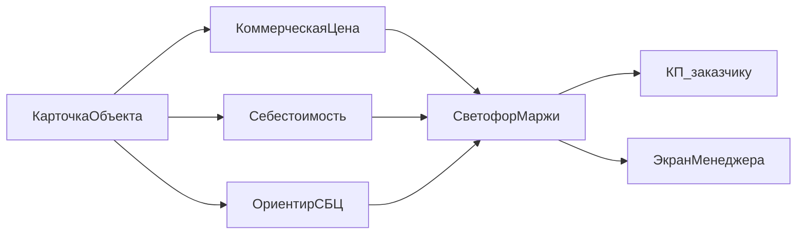

# Дорожная карта калькулятора ПИР

Карта утверждена. Код калькулятора начинается после фазы 0: пока нет политики цены и прайса из реальных договоров, боевые ставки не подставляются.

Продукт: внутренний веб-калькулятор менеджера. Заказчик видит только коммерческое КП. Себестоимость, маржа и СБЦ остаются на экране менеджера.

Объект расчёта: проектные работы по наружным сетям водоснабжения (В1), хозяйственно-бытовой канализации (К1), дождевой канализации (К2) и дренажа. Изыскания, авторский надзор и строительство в базу не входят: это отдельные строки, по умолчанию выключены.

## Как устроена цена

Три независимых числа на один расчёт.

- **Коммерческая цена** — то, что уходит в КП. Считается от прайса компании: метр трассы, точечные сооружения, опции, пакет, скидка.
- **Себестоимость** — часы ролей на участок и на объект, умноженные на внутренние ставки, плюс накладные. Это пол, ниже которого договор не продаём без отдельного разрешения.
- **Ориентир СБЦ** — справочная величина по СБЦП 81-2001-17 и текущему индексу на ПИР. Правила, таблицы и коэффициенты: [sbc-81-2001-17.md](sbc-81-2001-17.md), файл издания — [СБЦ №1.pdf](СБЦ%20№1.pdf). На счёт заказчику не попадает. Нужна, чтобы видеть, не отдали ли работу сильно ниже норматива и не оторвались ли от него вверх.

Коммерческая формула участка:

`цена = длина_м × ставка(тип, диаметр, условия, стадия) × К_глубины × К_способа × К_пакета`

Дальше плюсуются штучные позиции и опции, применяется скидка за общий коридор, срочность и скидка менеджера, затем проверяется минимальная сумма договора.

Ставка делится на две доли, обе настраиваются в прайсе:

- доля трассы (план, профиль, пересечения, увязка коридора);
- доля системы (гидравлика, колодцы, спецификация именно этой сети).

Если в одном коридоре несколько сетей, доля трассы у каждой следующей сети умножается на коэффициент повторного коридора (стартовое значение 0,75, калибруется на ваших договорах). Доля системы всегда 100%.

Светофор:

- зелёный — цена не ниже себестоимости и маржа не ниже целевой;
- жёлтый — маржа ниже целевой, но выше пола, либо коммерция сильно ниже или выше ориентира СБЦ;
- красный — цена ниже себестоимости. В КП такую сумму не выгружаем без явного разрешения руководителя, и это разрешение пишется в карточку расчёта.

## Что входит в расчёт, а что нет

Участок сети (несколько строк на объект, разный диаметр — разные строки):

- тип: В1, К1, К2, дренаж;
- длина, м;
- диаметр, мм, одна величина на строку;
- условия: поле, город, стеснённые, реконструкция;
- глубина: до 2 м, 2–4 м, глубже 4 м;
- способ: открытая прокладка, ГНБ, продавливание;
- стадия строки не нужна: стадия задаётся на весь объект (П, Р или П+Р).

Штучные позиции, их нельзя размазывать на метр:

- ВНС, КНС, ЛНС — по производительности, не «просто штуки»;
- локальные очистные и резервуары;
- дюкер;
- переход (дорога, ж/д, водная преграда) отдельно от способа прокладки трубы на участке.

Опции объекта, по умолчанию выключены:

- BIM в Civil 3D;
- сопровождение экспертизы;
- сбор исходных данных и согласования с балансодержателями;
- авторский надзор;
- изыскания (в КП отдельной строкой, в себестоимость проектирования не смешиваются).

Вне первой версии: автоматический подбор диаметров, подсчёт колодцев с чертежа, привязка к Civil 3D, личный кабинет заказчика, мультивалютность.

## СБЦ, не прайс

Издание зафиксировано: СБЦП 81-2001-17, официальный текст в [СБЦ №1.pdf](СБЦ%20№1.pdf). Как им пользоваться при расчёте ориентира — [sbc-81-2001-17.md](sbc-81-2001-17.md). Индекс Минстроя на ПИР — отдельное поле в [sbc-book.json](sbc-book.json), его меняют раз в квартал, не переписывая формулы.

Базовая цена строки: `a + b × X`, где `a` и `b` — тыс. руб. на 01.01.2001, а `X` — натуральный показатель таблицы (километры, метры, расход, штуки). Диаметр коммерческого прайса в эти таблицы не подставляется. Прочерк вместо `b` даёт цену `a` за объект. Промежуточный расход таблиц 16 и 17 интерполируется при одной длине.

Дальше множители самого справочника: доля стадии (П 0,60, Р 0,40), коэффициенты пункта и индекс квартала. Коммерческие коэффициенты глубины, способа прокладки и пакета на ориентир не переносятся. Выдуманные `a` и `b` в справочник не кладём: числа берутся из PDF.

Таблицы 16 и 17 применяются к новому населённому пункту или к системе, автономной от существующих сетей (п. 1.19). Если подходящей строки нет, ориентир СБЦ пустой и светофор помечает «нет строки СБЦ». Коммерческий расчёт при этом живёт.

## Пять фаз

**Фаза 0. Политика цены.** Документ решений, без интерфейса. Здесь появляются черновики ставок, ноль готовых «рыночных» цифр из воздуха.

Зафиксировать:

- регион и какой индекс ПИР подставляем;
- налоговый режим и как он сидит в себестоимости (накладные и налог отдельными множителями, не внутри ставки за метр);
- целевую маржу и пол (предложение для старта обсуждения: цель 35%, пол 20% — цифры меняются в фазе 0 по вашей экономике);
- кто имеет право увести цену ниже пола;
- потолок скидки менеджера (старт: 10% без руководителя);
- минимальную сумму договора;
- состав пакетов: Базовый (только Р, открытая прокладка, без экспертизы), Стандарт (П+Р), Экспертиза (Стандарт плюс сопровождение);
- доли «трасса / система» и коэффициент второго коридора;
- кто обновляет индекс ПИР. Издание уже зафиксировано: СБЦП 81-2001-17.

Источник ставок: 8–12 ваших закрытых договоров по наружным сетям. Если договоров нет, фаза 0 заканчивается пустым прайсом со структурой колонок и пометкой «нужна калибровка», калькулятор на фазе 3 считает, но КП помечает как черновик.

Шаблон решений: [pricing-policy.md](pricing-policy.md). Пустая структура прайса: [price-book.json](price-book.json), [cost-norms.json](cost-norms.json), [sbc-book.json](sbc-book.json).

**Фаза 1. Прайс и нормы времени.** Файлы данных, их читает и коммерция, и себестоимость.

- `price-book.json`: ставка руб/м по типу, диапазону диаметра, условиям и стадии; коэффициенты глубины и способа; штучные цены; цены опций; скидка коридора; минимум договора.
- `cost-norms.json`: часы ГИПа, проектировщика сетей, специалиста по колодцам и камерам, выпуска спецификаций — на 100 м и на каждое точечное сооружение; внутренние ставки руб/час; накладные.
- `sbc-book.json`: издание, коэффициенты стадий, текущий индекс и дата индекса. Правила расчёта — `sbc-81-2001-17.md`, числа `a` и `b` — в `СБЦ №1.pdf`. В движок пока перенесена только часть строк.

Диапазоны диаметров стартовые, их можно сузить после калибровки: до 110, 111–225, 226–400, 401–630, 631–1000, свыше 1000 мм. Дренаж часто живёт в нижних диапазонах, отдельная колонка типа сети это учитывает.

**Фаза 2. Движок.** Чистые функции без экрана: карточка на входе, три итога и список предупреждений на выходе. Проверяется на 6–8 эталонных карточках: одна сеть в поле, четыре сети в одном городском коридоре, реконструкция с ГНБ, объект ниже себестоимости, дырка в таблице СБЦ, скидка выше потолка. Эталоны лежат рядом с прайсом, чтобы смена ставки сразу показывала, какие договоры «поехали».

**Фаза 3. Внутренний калькулятор.** Локальное приложение в браузере, без сервера и без базы: прайс из файлов репозитория, расчёт сохраняется как JSON на компьютер менеджера.

Экраны:

- карточка объекта (заказчик, адрес, стадия, пакет);
- таблица участков;
- точечные сооружения и переходы;
- опции и скидка;
- итог менеджера: цена, себестоимость, маржа, СБЦ, светофор, перечень строк;
- печать КП: объект, стадия, состав работ, строки для заказчика (сети метражом, сооружения штуками, опции), итог и срок действия цены. Себестоимости и СБЦ в печати нет.

Стек первой версии: Vite и TypeScript. Логика расчёта отдельно от экрана, чтобы фазу 2 можно было проверить без браузера.

**Фаза 4. Калибровка.** Прогон тех же 8–12 договоров через калькулятор. Смотрим три отклонения: коммерция к факту договора, себестоимость к фактическим часам, СБЦ к коммерции. Правим прайс и нормы, не формулу, пока отклонение по коммерции на типовом объекте не уложится в согласованный допуск (старт обсуждения: ±15%). После этого снимаем пометку «черновик» с КП.

**Фаза 5. Как прайсом пользоваться дальше.** Индекс ПИР — раз в квартал, одна строка в `sbc-book.json`. Ставки руб/м — не чаще раза в полгода или после явного сдвига зарплат. Каждая правка прайса меняет версию, старые расчёты хранят номер версии, которой их посчитали. Публичный калькулятор для заказчика и чтение длин с чертежа Civil 3D — отдельные проекты после фазы 4, в эту дорожную карту не входят.

## Порядок работ

Сначала фаза 0: вопросник решений и пустая структура прайса в `knowledge-base/`. Цифры ставок появляются только из ваших договоров или явного указания. Фазы 1–3 имеют смысл подряд, как только политика цены утверждена. Фаза 4 блокирует «боевое» КП.

## Риски, которые карта уже учитывает

- Смешанный диаметр на одной трассе ломает одну ставку на весь объект. Поэтому единица ввода — участок, не объект.
- Насосные и очистные, умноженные на метр трубы, раздувают или обнуляют маржу. Они вынесены в штуки.
- Четыре сети в одной траншее нельзя складывать как четыре полных проекта. Для этого доля трассы и коэффициент коридора.
- Менеджерская скидка ниже себестоимости. Красный светофор и запрет выгрузки КП.
- Устаревший индекс ПИР. Дата индекса видна на экране менеджера, в КП её нет.
